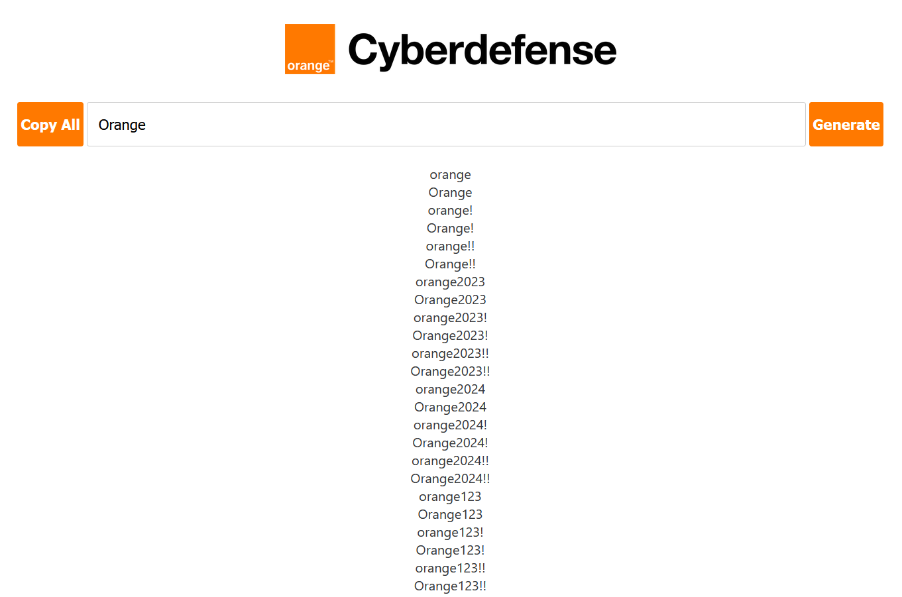

# BadPasswords

Create bad passwords based on a company name! \
Freely inspired by [badpass.io](https://badpass.io).

## Table of Contents

- [Usage](#usage)
- [Features](#features)
- [Development](#development)
- [Disclaimer](#disclaimer)

## Usage

Open `public/index.html` in a browser (or serve the `public/` folder), type a
company name and click **Generate**. Use **Copy All** to copy every generated
variation to the clipboard.



## Features

- Generates common weak-password variations from a base word.
- Leetspeak transforms: partial (first convertible character) and full.
- Appended suffixes: previous / current / next year (computed dynamically) and
  common numeric sequences (`123`, `1234`), each with `!` / `!!` variants.
- Capitalized variants of every combination, deduplicated.
- Generate with **Enter**, one-click **Copy All** with visual feedback.
- No framework and no build step — plain static HTML/CSS/JS.

## Development

```bash
npm install
npm test     # run the unit tests (Vitest)
npm run lint # ESLint
npm run format # Prettier
```

The generation logic lives in `public/js/generator.js` as pure, framework-free
functions and is fully unit-tested; `public/js/main.js` only wires it to the DOM.

## Disclaimer

This tool is intended for **security awareness** and **authorized** password
auditing (e.g. password-spraying wordlists during a sanctioned penetration
test). Do not use it to gain unauthorized access to any system or account.
